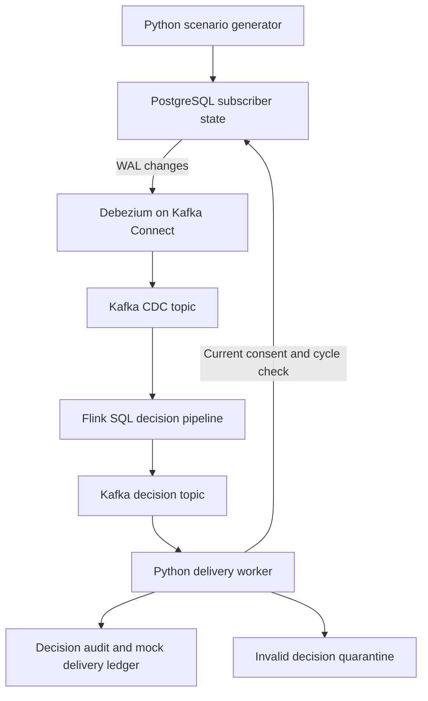

# Telecom marketing: CDC to a consent-aware top-up offer

An end-to-end reference implementation using **PostgreSQL → Debezium CDC → Kafka → Apache Flink SQL → Python → an auditable mock delivery ledger**.

**Validation status:** Python policy tests and Python compilation passed in the creation environment. Docker was not available there, so the full container stack has **not been executed or certified**. The repository includes a real integration test and GitHub Actions workflow to validate it on a Docker-capable machine. Treat this as an enterprise-oriented reference implementation, not a production deployment.

## 1. Business problem

A telecom operator wants to offer a data add-on when a subscriber consumes at least 80% of their monthly data allowance. A nightly campaign batch can miss the moment when the customer needs data. Independent systems can also send duplicate offers or use outdated consent.

**Example:** A synthetic customer has a 1,000 MB allowance. Their usage changes from 100 MB to 850 MB. The billing system commits this change. The pipeline evaluates the updated subscriber, checks consent again at delivery time, and records one simulated top-up offer for that billing cycle.

Rules:

- Usage is at least 80%, including exactly 80%.
- Account must be ACTIVE and marketing consent must be true.
- Maximum one `DATA_TOPUP_V1` delivery per customer and billing cycle.
- A candidate for an old billing cycle cannot be delivered.
- Source deletions are audited and cannot trigger offers.
- Replayed events cannot create duplicate mock deliveries.

No real subscriber data, phone numbers, SMS gateway, email service, or paid API is required. **No messages are sent to anyone.** Commercial impact is a hypothesis to evaluate, not a measured claim.

## 2. Architecture



| Component | What it actually does |
|---|---|
| PostgreSQL | Represents a telecom billing/CRM source. A trigger increments revision on each update. |
| CDC | The technique of capturing committed database changes, rather than polling all rows. |
| Debezium | Reads PostgreSQL logical replication and publishes before/after envelopes. |
| Kafka | Buffers events, separates producers from consumers, supports replay and consumer groups. |
| Flink | Runs continuous SQL over CDC events and emits a reason for each business decision. |
| Python | Generates source changes, starts services, verifies outcomes, and processes deliveries. |
| PostgreSQL marketing schema | Stores audit, quarantine, and the durable simulated provider ledger. Excluded from CDC to prevent loops. |

This design deliberately uses an **atomic subscriber-state row** rather than pretending independently arriving CRM and usage topics can always be joined consistently. An upstream billing system is assumed to maintain cumulative cycle usage. Flink does not aggregate individual network CDRs in this project. See [enterprise design](docs/enterprise.md) for that extension.

## 3. Requirements

- Docker Engine or Docker Desktop with Docker Compose v2, supporting `docker compose up --wait`.
- Python 3.10+ on your computer. Python dependencies run inside containers.
- Recommended allocation: 4 CPU cores, 8 GB RAM and 10 GB free disk; initial image downloads need internet access.
- Ports 8081 (Flink UI) and 8083 (Connect REST) free on localhost.
- Windows: start Docker Desktop with Linux containers. Use PowerShell with `python`, or `py` if that is your Python launcher. macOS/Linux may require `python3` instead of `python`.
- Baseline images target a Linux environment. On an ARM machine, if an image lacks a matching manifest, use an x86-64 machine or Docker emulation (`DOCKER_DEFAULT_PLATFORM=linux/amd64`).

The pinned baseline is Kafka 3.9.0, Debezium 3.0.0.Final, PostgreSQL 16.6, Flink 1.20.1, and Flink SQL Kafka connector 3.3.0-1.20. These are deliberate compatibility pins, **not claims that these versions are the newest or production-approved**. Perform vulnerability review and integration testing before upgrading.

## 4. Run the project

### Step 1 — Clone and enter the project

```bash
git clone https://github.com/yogesharya061/telecom-marketing-cdc.git
cd telecom-marketing-cdc
python --version
docker --version
docker compose version
```

All subsequent commands run from this directory. Do not install Kafka, Java, Flink, or PostgreSQL separately.

### Step 2 — Build and start

```bash
python scripts/run.py up
```

The startup script:

1. Builds the Python and Flink images, including the matching Kafka SQL connector JAR.
2. Starts PostgreSQL with logical replication and Kafka in KRaft mode (no ZooKeeper).
3. Waits for database and broker health checks.
4. Explicitly creates application topics and compacted Connect internal topics.
5. Starts Connect and registers the Debezium PostgreSQL connector.
6. Waits for connector task and Flink TaskManager readiness.
7. Submits `sql/pipeline.sql`, checks the job reaches RUNNING, and starts the worker.

First startup can take several minutes depending on downloads. The script fails on errors rather than printing a false success. `up` can be rerun: topics and connector configuration are reconciled, and an already active Flink job is not submitted again.

### Step 3 — Execute the complete business scenario

```bash
python scripts/run.py demo
```

The demo uses a unique customer prefix on each run, so it can be repeated without deleting data. It inserts five synthetic subscribers, waits for CDC audit records, changes their usage, and waits for expected results.

| Customer suffix | Source state after usage update | Expected result |
|---|---|---|
| 1 | 850 / 1,000 MB, active, consent | SIMULATED_SENT |
| 2 | 850 / 1,000 MB, no consent | NO_CONSENT |
| 3 | 850 / 1,000 MB, suspended | INACTIVE |
| 4 | 790 / 1,000 MB, active, consent | BELOW_THRESHOLD |
| 5 | 850 / 1,000 MB, active, consent | SIMULATED_SENT |

It then asserts a frequency cap after another update, consent revocation, source deletion, exact event replay, and quarantine of malformed output. Successful completion prints `All integration assertions passed` and exactly two mock deliveries for that run. Timeouts fail the command and CI.

### Step 4 — Inspect the results

Open the Flink UI at <http://localhost:8081>. Find `telecom-marketing-v1` and inspect its graph, records, checkpoints, and backpressure.

```bash
docker compose exec postgres psql -U demo -d telecom -c "SELECT * FROM marketing.deliveries ORDER BY delivered_at DESC;"
docker compose exec postgres psql -U demo -d telecom -c "SELECT reason,count(*) FROM marketing.decisions GROUP BY reason;"
docker compose exec postgres psql -U demo -d telecom -c "SELECT * FROM marketing.quarantine;"
docker compose logs --tail 50 worker
```

View raw CDC envelopes (Ctrl+C stops the viewer):

```bash
docker compose exec kafka /opt/kafka/bin/kafka-console-consumer.sh --bootstrap-server kafka:9092 --topic telecom.crm.subscribers --from-beginning
```

View Flink decisions:

```bash
docker compose exec kafka /opt/kafka/bin/kafka-console-consumer.sh --bootstrap-server kafka:9092 --topic marketing.decisions --from-beginning
```

### Step 5 — Make your own database change

```bash
docker compose exec postgres psql -U demo -d telecom
```

Paste this SQL into the database prompt:

```sql
INSERT INTO crm.subscribers
(customer_id,billing_cycle,used_mb,quota_mb,marketing_consent,account_status)
VALUES ('my-demo-customer','2026-10',300,1000,true,'ACTIVE');

UPDATE crm.subscribers SET used_mb=850
WHERE customer_id='my-demo-customer';

-- Wait a few seconds, then inspect:
SELECT * FROM marketing.deliveries WHERE customer_id='my-demo-customer';

-- Another eligible update does not create another offer:
UPDATE crm.subscribers SET used_mb=950 WHERE customer_id='my-demo-customer';

-- New billing cycle permits a new offer if other rules pass:
UPDATE crm.subscribers SET billing_cycle='2026-11',used_mb=850
WHERE customer_id='my-demo-customer';
```

Exit psql with `\q`. Choose a different ID if repeating this insert. The demo's cycle is a business identifier, not an automatically advancing wall-clock date.

### Step 6 — Run tests

Fast policy tests need only Python, without Docker or third-party libraries:

```bash
python -m unittest discover -s tests -v
```

Or run the same tests inside the built image:

```bash
python scripts/run.py test
```

`python scripts/run.py demo` is the real integration test; unit tests alone do not prove Kafka/Debezium/Flink compatibility. The included GitHub Actions workflow runs both, checks Compose configuration, and uploads logs even on failure.

### Step 7 — Stop or reset

```bash
python scripts/run.py down
```

This preserves named volumes. On the next `up`, a newly submitted Flink job reads from retained earliest Kafka offsets; the persistent delivery ledger handles duplicates. This is replay recovery, not automatic restoration of a saved Flink job.

**Destructive reset of this demo's data only:**

```bash
docker compose down -v
python scripts/run.py up
python scripts/run.py demo
```

Removing volumes deletes the database, Kafka events/offsets and checkpoints. Never use this command against a deployment with data you need to retain.

## 5. How correctness works

Debezium emits `c` (create), `u` (update), `d` (delete), and `r` (snapshot read). PostgreSQL `REPLICA IDENTITY FULL` supplies the before image for deletes and updates. Flink reads the envelope as ordinary JSON so it can emit an append-only decision per change; it does not use a retracting `debezium-json` dynamic table.

A decision contains `event_id`, `customer_id`, `billing_cycle`, `revision`, `campaign_id`, and `reason`. Event IDs combine customer, cycle, revision and operation. Customer IDs must not be reused after deletion, and revisions must remain monotonic. A snapshot `r` and a create `c` may have different audit IDs, but the delivery key still protects the customer.

The Python worker locks the current subscriber row, rechecks eligibility for ELIGIBLE candidates, writes the audit and mock delivery in one transaction, and **only then commits the Kafka offset**. A crash between DB commit and offset commit causes replay, which is safe due to primary keys. Consent changes and mock delivery serialize on the row lock: a revocation committed first blocks delivery; a later revocation cannot undo a delivery already recorded.

Kafka/Flink output is **at least once**. Flink checkpoints its source progress, but this does not make a real SMS side effect exactly once. The idempotent PostgreSQL ledger provides one mock delivery per campaign/customer/cycle. A real provider needs a transactional outbox and provider idempotency support; see the enterprise document.

Malformed decision records are stored in `marketing.quarantine`, with Kafka topic/partition/offset as a deduplication key. Malformed raw CDC JSON **fails the Flink job visibly** instead of being silently dropped. This implementation intentionally does not promise a raw-byte CDC DLQ or automatic schema migration.

## 6. Files and responsibilities

| Path | Purpose |
|---|---|
| `compose.yaml` | Local services, volumes, health checks, network |
| `connect/subscribers.json` | Debezium connector and capture scope |
| `sql/init.sql` | Source tables, revision trigger, publication, marketing ledger |
| `sql/pipeline.sql` | Continuous Flink eligibility and reason-code computation |
| `flink/Dockerfile` | Flink image with Kafka connector |
| `app/policy.py` | Current-state delivery guard and contract checks |
| `app/worker.py` | Transactional delivery consumer and quarantine |
| `app/bootstrap.py` | Topic creation and readiness polling |
| `app/demo.py` | Source generator and real-stack assertions |
| `scripts/run.py` | Cross-platform startup orchestration |
| `tests/test_policy.py` | Rule boundary and invalid-contract tests |
| `.github/workflows/ci.yml` | Unit and full integration CI |
| `docs/enterprise.md` | Scale, failure modes, SLOs, privacy and rollout design |
| `docs/runbook.md` | Troubleshooting and operations |

## 7. Repository and CI

Repository: <https://github.com/yogesharya061/telecom-marketing-cdc>

The included GitHub Actions workflow runs on pushes, pull requests, and manual dispatch. Open [Actions](https://github.com/yogesharya061/telecom-marketing-cdc/actions) and inspect `Verify telecom pipeline`. Both the unit and integration jobs must pass before treating a revision as integration-verified. Failed runs retain Compose logs as downloadable artifacts.

For changes, create a branch, update the code and tests, and open a pull request. Keep production credentials out of this repository. The committed `demo` database credentials are for the isolated synthetic local stack only.

## 8. Technology references

- [Debezium PostgreSQL connector](https://debezium.io/documentation/reference/3.0/connectors/postgresql.html): logical replication, snapshots, replica identity.
- [Flink Kafka SQL connector](https://nightlies.apache.org/flink/flink-docs-release-1.20/docs/connectors/table/kafka/): Kafka source/sink configuration and guarantees.
- [Connector release artifact](https://repo1.maven.org/maven2/org/apache/flink/flink-sql-connector-kafka/3.3.0-1.20/): pinned JAR coordinates.
- [Debezium container setup](https://hub.docker.com/r/debezium/connect): Connect environment configuration.

The source code and configuration, not an illustrative architecture diagram, determine the guarantees implemented here.
